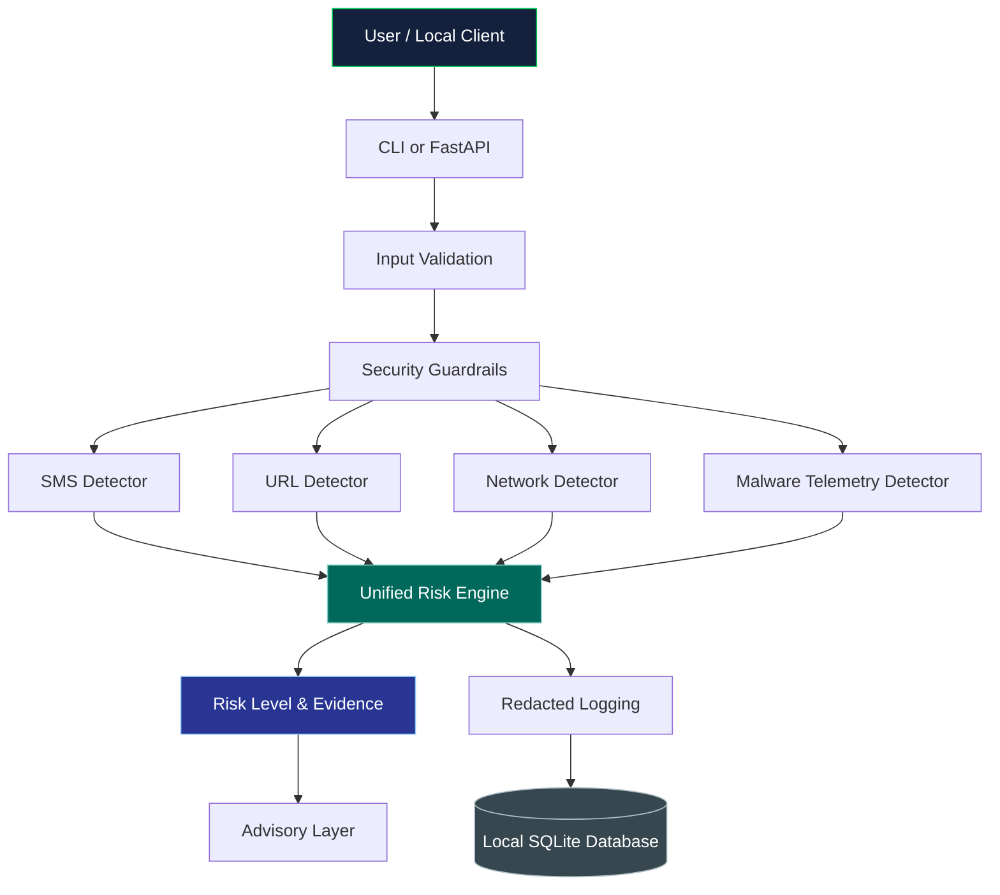

# 🛡️ SurakshaEdge AI
### Privacy-First AI-Powered Cybersecurity & Threat Detection

<p align="center">
  
  
  
  
  
</p>

<p align="center">
  <strong>Detect threats. Understand risks. Protect your data.</strong>
</p>

<p align="center">
  A local-first cybersecurity assistant designed to analyze suspicious messages, malicious URLs, network traffic patterns, and malware-related system telemetry — without relying on cloud-based threat analysis by default.
</p>

<p align="center">
  <a href="#-key-features">Features</a> •
  <a href="#-architecture">Architecture</a> •
  <a href="#-installation">Installation</a> •
  <a href="#-api-quick-start">API Quick Start</a> •
  <a href="#-privacy--security">Privacy</a>
</p>

---

## 📑 Table of Contents

- [Overview](#-overview)
- [Key Features](#-key-features)
- [Why SurakshaEdge AI](#-why-surakshaedge-ai)
- [Architecture](#-architecture)
- [Technology Stack](#-technology-stack)
- [Project Structure](#-project-structure)
- [Installation](#-installation)
- [Run the Application](#-run-the-application)
- [API Quick Start](#-api-quick-start)
- [CLI Usage](#-cli-usage)
- [Model Training & Evaluation](#-model-training--evaluation)
- [Testing](#-testing)
- [Privacy & Security](#-privacy--security)
- [Limitations](#-limitations)
- [Future Improvements](#-future-improvements)
- [Contributing](#-contributing)
- [License](#-license)

---

## 🔎 Overview

**SurakshaEdge AI** is a privacy-preserving cybersecurity research prototype built to demonstrate multi-vector threat detection on local systems and edge-ready environments.

Instead of depending on a remote cloud service for every analysis, the application combines deterministic security rules, lightweight machine learning models, and a unified risk-scoring engine.

### 🎯 Project Objectives

- Identify suspicious messages and scam patterns.
- Detect potentially malicious URLs using structural features and local threat intelligence.
- Analyze network-flow metadata for anomalous activity.
- Evaluate malware-related system telemetry using defensive heuristics.
- Combine detection signals into an understandable risk assessment.
- Minimize sensitive data retention through local processing and redacted logging.

> **Important:** This project is a research prototype. Its bundled datasets and models include synthetic demonstration artifacts and should not be treated as production-grade threat intelligence or a guarantee of security.

---

## ✨ Key Features

<table>
  <tr>
    <td width="50%">
      <h3>💬 SMS & Scam Detection</h3>
      Analyze message text for phishing, impersonation, credential theft, urgent financial demands, and suspicious wording.
    </td>
    <td width="50%">
      <h3>🔗 URL Threat Analysis</h3>
      Examine URL structure, suspicious domains, IP-based hosts, punycode, shortened links, and local threat-intelligence matches.
    </td>
  </tr>
  <tr>
    <td width="50%">
      <h3>🌐 Network Anomaly Detection</h3>
      Inspect network-flow metadata such as packet rates, connection patterns, port risks, and failed connections.
    </td>
    <td width="50%">
      <h3>🦠 Malware Telemetry Analysis</h3>
      Evaluate suspicious process activity, persistence indicators, unusual executable locations, and privilege-related signals.
    </td>
  </tr>
  <tr>
    <td width="50%">
      <h3>⚖️ Unified Risk Engine</h3>
      Combine multiple detector signals into low, medium, high, or critical risk assessments with explanatory evidence.
    </td>
    <td width="50%">
      <h3>🔒 Local-First Processing</h3>
      Keep analysis local by default, with redacted logging and local SQLite persistence.
    </td>
  </tr>
</table>

---

## 💡 Why SurakshaEdge AI?

| Capability | What it offers |
|---|---|
| Multi-vector detection | Message, URL, network-flow, and malware-telemetry analysis |
| Explainable risk | Risk categories supported by detector signals |
| Local execution | Designed for offline-first operation |
| Lightweight ML | Scikit-learn classifiers alongside deterministic rules |
| Privacy-aware storage | Hashing, redaction, and minimized evidence retention |
| Developer-friendly | CLI, REST API, Docker configuration, and automated tests |
| Edge-ready direction | Designed with local and resource-conscious deployment in mind |

---

## 🏗️ Architecture

The following diagram illustrates the main analysis pipeline.



### 🔄 Analysis Pipeline

1. **Input:** Accept message text, a URL, network-flow metadata, or supported telemetry indicators.
2. **Validation:** Apply input validation and security-related checks.
3. **Detection:** Run the appropriate rules and machine learning components.
4. **Risk assessment:** Combine available detector signals through the risk engine.
5. **Explanation:** Provide a risk assessment and supporting evidence.
6. **Persistence:** Store permitted, redacted analysis metadata locally.

---

## 🛠️ Technology Stack

| Technology | Purpose |
|---|---|
| Python | Core application and detection logic |
| FastAPI | REST API |
| Scikit-learn | Lightweight machine learning |
| TF-IDF & Logistic Regression | Message classification |
| Random Forest | URL and network-flow classification |
| SQLite | Local alert and analysis storage |
| Pydantic | Configuration and request/response validation |
| Pytest | Automated testing |
| Docker | Containerized execution |
| ExecuTorch adapter | Optional local Llama runtime integration boundary |

---

## 📂 Project Structure

```text
surakshaedge-ai/
├── data/                   # Datasets and local threat intelligence
├── frontend/               # Frontend-related project files
├── models/                 # Trained model artifacts and metadata
├── scripts/                # Data generation and utility scripts
├── src/
│   ├── api.py              # FastAPI application
│   ├── config.py           # Application configuration
│   ├── schemas.py          # Request and response schemas
│   ├── sms_detector.py     # Message detection
│   ├── url_detector.py     # URL threat detection
│   ├── network_detector.py # Network anomaly detection
│   ├── malware_detector.py # Telemetry heuristics
│   ├── risk_engine.py      # Unified risk scoring
│   ├── advisor.py          # Advisory generation
│   ├── storage.py          # SQLite persistence
│   ├── security.py         # Security and redaction helpers
│   └── metrics.py          # Performance counters
├── static/                 # Static assets
├── tests/                  # Unit and integration tests
├── app.py                  # Application entry point
├── train_models.py         # Model training
├── evaluate_models.py      # Model evaluation
├── requirements.txt        # Python dependencies
├── pyproject.toml          # Project tooling configuration
├── Dockerfile              # Docker build configuration
├── docker-compose.yml      # Docker Compose configuration
├── Makefile                # Development shortcuts
├── .env.example            # Example environment configuration
└── README.md
```

---

## ⚙️ Installation

### Prerequisites

- Python 3.11 or higher
- Git
- pip
- Docker (optional)

### 1. Clone the Repository

```bash
git clone https://github.com/ShivamGupta1111/surakshaedge-ai.git
cd surakshaedge-ai
```

### 2. Create a Virtual Environment

**Windows PowerShell**

```powershell
python -m venv .venv
.venv\Scripts\Activate.ps1
```

**Linux / macOS**

```bash
python3 -m venv .venv
source .venv/bin/activate
```

### 3. Install Dependencies

```bash
python -m pip install --upgrade pip
pip install -r requirements.txt
```

---

## 🚀 Run the Application

Start the local application:

```bash
python app.py
```

Alternatively, start the FastAPI server with Uvicorn:

```bash
uvicorn src.api:app --host 127.0.0.1 --port 8000 --reload
```

When the server is running, open:

- **Interactive API documentation:** http://127.0.0.1:8000/docs
- **Alternative API documentation:** http://127.0.0.1:8000/redoc
- **Health check:** http://127.0.0.1:8000/health

These URLs assume the server is running locally on port 8000.

---

## 🔌 API Quick Start

### Health Check

```bash
curl http://127.0.0.1:8000/health
```

### Analyze a Suspicious Message

```bash
curl -X POST http://127.0.0.1:8000/api/v1/analyze/message \
  -H "Content-Type: application/json" \
  -d '{"message":"URGENT: Verify your bank account immediately."}'
```

### Analyze a URL

```bash
curl -X POST http://127.0.0.1:8000/api/v1/analyze/url \
  -H "Content-Type: application/json" \
  -d '{"url":"http://paypa1-secure-login.top/verify"}'
```

### Analyze Network-Flow Metadata

```bash
curl -X POST http://127.0.0.1:8000/api/v1/analyze/network-flow \
  -H "Content-Type: application/json" \
  -d '{
    "duration": 0.1,
    "protocol": "tcp",
    "src_port": 1234,
    "dst_port": 4444,
    "fwd_packets": 40,
    "bwd_packets": 0,
    "packet_rate": 2500,
    "failed_count": 12,
    "repeated_dst": 25,
    "conn_freq": 60,
    "syn_count": 40
  }'
```

### Retrieve Local Alert Logs

```bash
curl http://127.0.0.1:8000/api/v1/alerts
```

For exact request schemas and response fields, consult the interactive API documentation.

---

## ⌨️ CLI Usage

Analyze a message:

```bash
python app.py analyze-message \
  "Your package delivery failed. Verify your details."
```

Analyze a URL:

```bash
python app.py analyze-url \
  "http://192.0.2.55/login/wallet"
```

Run a network-flow demonstration:

```bash
python app.py analyze-flow-demo
```

---

## 🧠 Model Training & Evaluation

Generate the bundled demonstration datasets:

```bash
python scripts/generate_sample_data.py
```

Train the local models:

```bash
python train_models.py \
  --data-dir data \
  --model-dir models \
  --allow-overwrite
```

Evaluate trained models:

```bash
python evaluate_models.py \
  --data-dir data \
  --model-dir models
```

Review the generated evaluation metrics and confusion matrices before making any claims about model accuracy or real-world detection performance.

> The bundled datasets are synthetic demonstration data. Strong results on synthetic data do not establish effectiveness against real-world threats.

---

## 🧪 Testing

Run the automated test suite:

```bash
python -m pytest -q
```

Run the end-to-end smoke test:

```bash
python scripts/smoke_test.py
```

The repository includes detector, risk-engine, API, security, advisory, and pipeline test modules.

---

## 🐳 Docker

The repository includes a `Dockerfile` and Docker Compose configuration.

Build the image:

```bash
docker build -t surakshaedge-ai .
```

For Docker Compose, inspect `docker-compose.yml` and follow the service configuration defined in the repository:

```bash
docker compose up --build
```

---

## 🔐 Privacy & Security

Privacy is a core design goal of SurakshaEdge AI.

- **Local-first analysis:** Detection is designed to run locally without sending analyzed content to third-party cloud services by default.
- **Sensitive-data redaction:** Logging helpers scrub selected credentials and personal identifiers.
- **Reduced data retention:** The persistence layer is designed to store hashes, risk scores, detector metadata, and redacted evidence rather than raw message content by default.
- **SSRF defenses:** URL-related safeguards address private, loopback, link-local, and cloud metadata destinations.
- **Trusted model artifacts:** Model loading is restricted to trusted local artifacts, with optional checksum verification.

**Security note:** These safeguards reduce certain risks but do not guarantee complete privacy or immunity from attacks. Review configuration, dependencies, deployment exposure, and storage behavior before using real sensitive data.

---

## ⚠️ Limitations

- This is a defensive research prototype, not a replacement for enterprise security monitoring.
- Bundled training data includes synthetic demonstration datasets.
- Detection quality depends on the training data, feature design, rules, and model artifacts.
- Novel threats and deliberate evasion may not be detected.
- The optional ExecuTorch integration requires a compatible runtime and model artifact.
- Local processing does not automatically guarantee that every deployment, dependency, or log is secure.

---

## 🔮 Future Improvements

Potential development directions include:

- [ ] Evaluate detection on representative, appropriately licensed real-world datasets.
- [ ] Improve multilingual scam and phishing detection.
- [ ] Add richer explainability and actionable remediation reports.
- [ ] Benchmark CPU and memory usage across edge devices.
- [ ] Improve model drift monitoring and retraining workflows.
- [ ] Expand security regression and integration testing.
- [ ] Add an accessible monitoring dashboard.
- [ ] Strengthen packaging, deployment automation, and reproducibility.

---

## 🤝 Contributing

Contributions, bug reports, and improvement suggestions are welcome.

1. Fork the repository.
2. Create a feature branch.
3. Implement your change and add tests where appropriate.
4. Run the test suite.
5. Open a pull request describing the change.

Please do not commit secrets, API credentials, personal data, or sensitive security logs.

---

## 📜 License

This project is distributed under the **MIT License**. See the [`LICENSE`](LICENSE) file for the complete terms.

---

## ⭐ Support the Project

If you find SurakshaEdge AI useful:

- ⭐ Star the repository.
- 🐛 Report reproducible bugs.
- 💡 Suggest improvements.
- 🤝 Contribute code or documentation.

<p align="center">
  <strong>SurakshaEdge AI — Security with privacy at the edge.</strong>
</p>

<p align="center">
  <a href="https://github.com/ShivamGupta1111/surakshaedge-ai">Explore the Repository</a>
</p>
